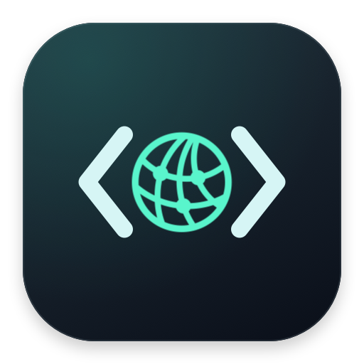
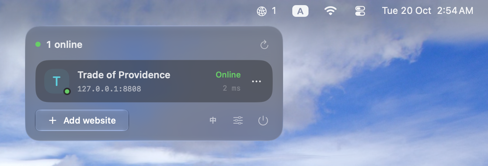
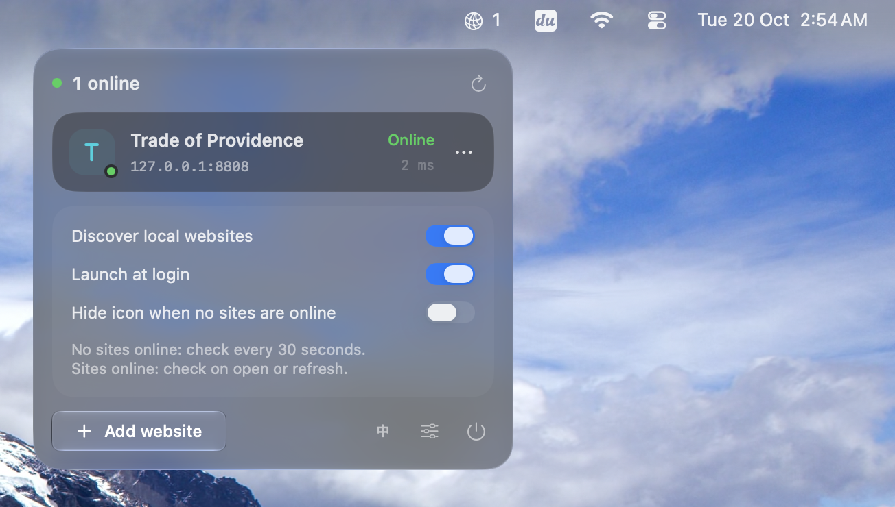

# LocalWatch



**English** | [简体中文](README.zh-CN.md)

A lightweight macOS menu bar app for discovering, checking, and opening local websites. Built with SwiftUI and Liquid Glass, with no third-party runtime dependencies.

## Screenshots





## Features

- Discover HTTP services owned by your current user and open them in your default browser.
- Add, edit, copy, or remove local URLs manually.
- View HTTP availability and response times in a compact, adaptive panel.
- After a completed check finds zero online sites, check every 30 seconds. Once at least one site responds, stop polling and check only when the panel opens or you click refresh. No polling before the first check.
- Optionally hide the menu bar icon when no sites are online. Restore it when a site returns; reopening the app also reveals the panel. The icon stays visible while the panel is open.
- Switch between English and Chinese with the **EN / 中** button. Your choice is remembered.
- Launch at login and quit directly with the power icon.
- Keep settings on your Mac, with no account or telemetry uploads.

## Install

Requires **Apple Silicon and macOS 26 or later**. Intel builds are not included.

1. Download `LocalWatch-v1.1.0-macos-arm64.zip` from [Releases](https://github.com/ethan6945/LocalWatch/releases/latest).
2. Unzip and move `LocalWatch.app` to Applications.
3. Open it and click its menu bar icon. There is no Dock icon.

The app is ad-hoc signed, without Developer ID signing or Apple notarization. Gatekeeper may block it on another Mac. After verifying its source, follow macOS Privacy & Security prompts to allow it, or build from source.

To verify the download, put the ZIP and `SHA256SUMS.txt` in the same folder and run:

```sh
shasum -a 256 -c SHA256SUMS.txt
```

## How status works

Green means HTTP 200–399; orange means HTTP 400–599 and still counts as online. A failed connection, timeout, or TLS error is retried once before the site is hidden. Offline sites are remembered and return on a later successful check. HTTP availability does not establish application health.

Manual URLs accept HTTP / HTTPS on `localhost`, `127.x.x.x`, or `::1`, such as `http://localhost:3000/` or `http://[::1]:8080/`. Probes never follow redirects. Automatic discovery uses IPv4 HTTP; add HTTPS-only or IPv6-only sites manually. Removed URLs are excluded from automatic discovery until manually added again.

## Build

Install Apple Command Line Tools with `xcode-select --install`, then run:

```sh
./build.command
open LocalWatch.app
```

No Xcode project or package manager is required. A compatible Swift toolchain and macOS SDK are needed. The script tries installed SDKs if SwiftUI macro support is unavailable in the selected SDK.

Release builds optimize for size, use whole-module optimization and linker dead stripping, and strip local symbols before signing. Icon PNG payloads are losslessly optimized, preserving their pixel content and available resolutions.

See [CHANGELOG.md](CHANGELOG.md) for release history.

## Support

[](https://buymeacoffee.com/ethan6945)
